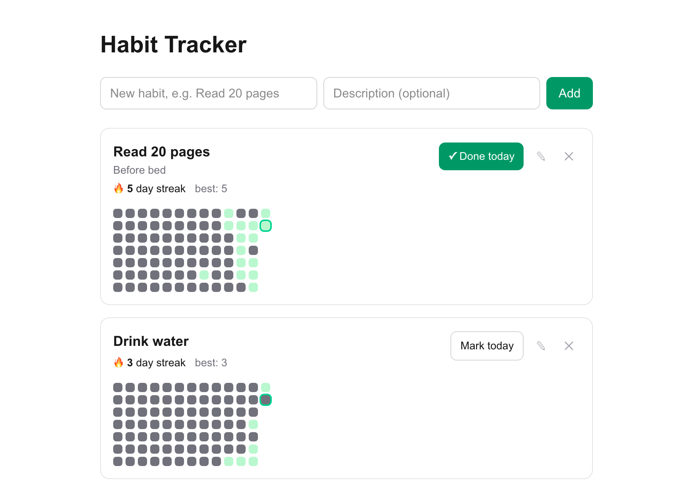
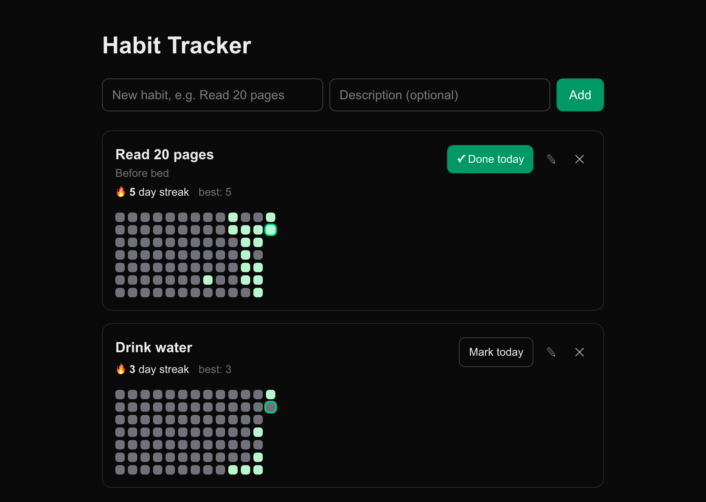

# Habit Tracker

A small full-stack app for building daily habits: mark a habit as done each day, keep your streak alive, and see your history on a GitHub-style calendar heatmap.

Built with **ASP.NET Core + EF Core + PostgreSQL** on the backend and **Next.js 16 (App Router)** on the frontend.

| Light | Dark |
|---|---|
|  |  |

## Features

- **Habits CRUD** — create, rename, describe and delete habits.
- **Daily check-ins** — one click to mark today as done (or undo it), with an optimistic UI that updates instantly.
- **Streaks** — current streak and best-ever streak for every habit.
- **Calendar heatmap** — the last 12 weeks at a glance, today highlighted, date on hover.
- **Light and dark theme** — follows the system setting.

## Tech stack

| Layer | Technology |
|---|---|
| Frontend | Next.js 16 (App Router, Server Components, Server Actions), React 19, TypeScript, Tailwind CSS 4 |
| Backend | ASP.NET Core (.NET 10) Minimal APIs |
| Data | Entity Framework Core 10, PostgreSQL 17 (Docker) |
| Tests | xUnit |

## Architecture

```
Browser ──▶ Next.js server ──▶ ASP.NET Core API ──▶ PostgreSQL
            (Server Components    (Minimal API,         (Docker)
             + Server Actions)     EF Core)
```

The browser never talks to the .NET API directly. The page is a Server Component that fetches habits on the server, and every mutation goes through a Server Action that calls the API and then refreshes the page. This keeps the API internal, needs no CORS in practice, and lets the UI update in a single round trip.

## How streaks work

Streak logic lives in a pure, framework-free class ([`StreakCalculator`](api/Services/StreakCalculator.cs)) and was built test-first: the [test suite](api.Tests/StreakCalculatorTests.cs) was written as a specification before the implementation.

- **Current streak** — consecutive days ending today. If today isn't checked in yet but yesterday is, the streak is still alive: the day isn't over.
- **Longest streak** — the longest run of consecutive days ever.
- Unsorted input and duplicate dates are handled.

`today` is passed in as a parameter rather than read from the clock, so the tests are deterministic.

## API

| Method | Route | Description |
|---|---|---|
| `GET` | `/api/habits` | List habits with streaks and check-in dates |
| `GET` | `/api/habits/{id}` | Get one habit |
| `POST` | `/api/habits` | Create a habit |
| `PUT` | `/api/habits/{id}` | Update name / description |
| `DELETE` | `/api/habits/{id}` | Delete a habit (its check-ins are removed by cascade) |
| `PUT` | `/api/habits/{id}/checkins/{date}` | Check in for a day (`YYYY-MM-DD`, idempotent, future dates rejected) |
| `DELETE` | `/api/habits/{id}/checkins/{date}` | Undo a check-in |

Example requests are in [`api/Api.http`](api/Api.http) (works with the VS Code REST Client extension).

### Data model

- **Habit** — `Id`, `Name` (max 100), `Description?`, `CreatedAt`
- **CheckIn** — `Id`, `HabitId` → Habit (cascade delete), `Date` (`date`, no time)
- A unique index on `(HabitId, Date)` guarantees at most one check-in per habit per day.

## Getting started

### Prerequisites

- [.NET 10 SDK](https://dotnet.microsoft.com/download)
- Node.js 20+
- Docker

### Run locally

```bash
# 1. Database
docker compose up -d

# 2. API — applies migrations, then starts on http://localhost:5172
dotnet tool restore
dotnet ef database update --project api
dotnet run --project api

# 3. Frontend — http://localhost:3000
cd web
npm install
npm run dev
```

The frontend reads the API address from the `API_URL` environment variable (default `http://localhost:5172`).

### Run tests

```bash
dotnet test
```

## Project structure

```
.
├── api/                    ASP.NET Core Web API
│   ├── Data/               DbContext and model configuration
│   ├── Endpoints/          Minimal API route handlers and DTOs
│   ├── Migrations/         EF Core migrations
│   ├── Models/             Habit, CheckIn entities
│   └── Services/           StreakCalculator
├── api.Tests/              xUnit tests for streak logic
├── web/                    Next.js frontend
│   └── src/
│       ├── app/            Page, layout, Server Actions
│       ├── components/     HabitCard, HabitHeatmap, NewHabitForm
│       └── lib/            API types and helpers
└── docker-compose.yml      PostgreSQL
```

## What I learned

This project was my first time working with .NET, coming from a React / Next.js background:

- Structuring an ASP.NET Core Minimal API with route groups, DI and typed DTOs (`record`s).
- EF Core: entities, relationships, conventions, Fluent API configuration, migrations, change tracking and `Include`.
- Test-driven development with xUnit: writing the spec as tests first, then making them pass.
- Next.js 16 patterns: Server Components, Server Actions, `refresh()`, `useOptimistic`, and opting a page into dynamic rendering.

## Ideas for the future

- Check in for past days by clicking a heatmap square
- Docker images for the API and the frontend
- Authentication and per-user habits
- Time zone support (dates are currently based on the server's local time)
